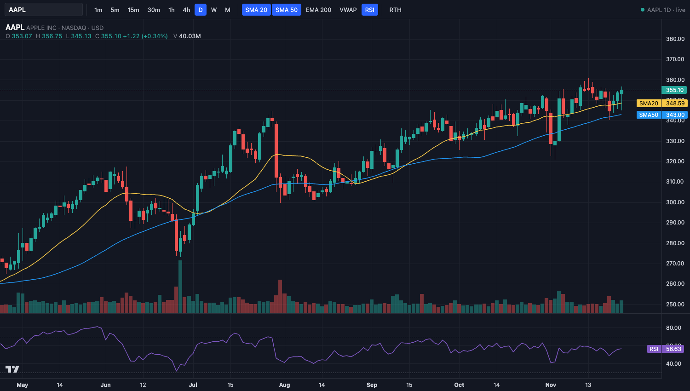

# ib-charts

TradingView-style charts that run on your own computer and use the market data you already pay Interactive Brokers for. No TradingView subscription needed.



- **Single Rust binary.** It connects to IB Gateway / TWS and serves a web UI on `localhost`.
- **History plus live updates.** It loads past bars, then keeps the current bar updating (IB's `keepUpToDate` historical stream).
- **Charts:** candles, volume, SMA 20 / SMA 50 / EMA 200, session VWAP and RSI(14).
- **Timeframes:** 1m, 5m, 15m, 30m, 1h, 4h, D, W, M, with an RTH-only toggle.
- **Markets:** stocks (US and international), forex, futures (picks the front month automatically), indices and crypto.
- **Symbol search** with autocomplete. Start typing anywhere on the page to change the symbol.
- **Read-only.** The code only requests market data and contains no order placement code.

Charts are drawn with TradingView's open-source [Lightweight Charts™](https://github.com/tradingview/lightweight-charts) (Apache-2.0). It is built into the binary, so the app runs fully offline apart from IB.

## Requirements

- [Rust](https://rustup.rs) (stable)
- IB Gateway or TWS running and logged in, with the API enabled:
  **Configure → Settings → API → Settings**
  - ✅ Enable ActiveX and Socket Clients
  - ✅ **Read-Only API** (recommended; see [Read-only setup](#read-only-setup))
  - Socket port: `4001` (Gateway live), `4002` (Gateway paper), `7496`/`7497` (TWS)
  - Trusted IPs: `127.0.0.1`
- Market data subscriptions for whatever you want to chart. Without one, IB returns error 162/354.

## Run

```sh
cargo run --release                     # Gateway live on 4001, opens http://127.0.0.1:8088
cargo run --release -- --ib-port 4002   # paper Gateway
cargo run --release -- --help           # all options
```

Options can also be set with environment variables: `IB_HOST`, `IB_PORT`, `IB_CLIENT_ID`, `LISTEN`.

| Option | Default | |
|---|---|---|
| `--ib-host` | `127.0.0.1` | Gateway / TWS host |
| `--ib-port` | `4001` | API port |
| `--client-id` | `77` | Must differ from other API apps on the same Gateway |
| `--listen` | `127.0.0.1:8088` | Web UI address |
| `--no-open` | | Don't open the browser |
| `--data-dir` | per-user app-data dir | Where settings, watchlist, drawings, scripts and layouts are saved |

Your data is saved as plain files you can back up or sync:
macOS `~/Library/Application Support/io.github.ib-charts/`, Linux `~/.local/share/ib-charts/`,
Windows `%APPDATA%\ib-charts\data\`.

## Symbol syntax

| Type | Example |
|---|---|
| US stock | `AAPL`, `BRK B` |
| Other stock (`SYMBOL:EXCHANGE:CURRENCY`) | `SHOP:TSE:CAD`, `7203:TSEJ:JPY`, `VOD:LSE:GBP` |
| Forex | `EUR.USD`, `USD.JPY` |
| Futures (front month) | `/ES`, `/NQ`, `/CL:NYMEX`, `/GC:COMEX` |
| Index (optional `:EXCHANGE`) | `^SPX`, `^NDX`, `^VIX`, `^DAX` |
| Crypto | `$BTC`, `$ETH` |

## IB limits to know

- **Historical-data pacing.** IB throttles historical requests (roughly 60 per 10 minutes for small bars). Switching symbols or timeframes very quickly can return a pacing error. Wait a bit and try again.
- **One market-data session per username.** If you log in to TWS or IBKR Mobile with the same user, the Gateway can lose its market data. A second, read-only user avoids this (see below).
- **Gateway daily restart.** The app reconnects automatically and the page resubscribes.
- **What's charted.** Forex and crypto charts use MIDPOINT data, which has no volume. Index charts have no volume either.

## Read-only setup

You can protect against accidental orders at two levels:

1. **API level.** In IB Gateway, go to **Configure → Settings → API → Settings** and tick **Read-Only API**. Any API app connected to this Gateway can then read data but can't place orders.
2. **Account level.** In IBKR Client Portal, create a secondary user with no trading rights and log the Gateway in as that user. Note that market data subscriptions are per user, so the new user needs its own.

## How it works

```
browser (Lightweight Charts) ⇄ WebSocket ⇄ ib-charts (axum + ibapi) ⇄ IB Gateway / TWS
```

- `src/contracts.rs`: turns what you type into a fully resolved IB contract via `reqContractDetails`.
- `src/timeframe.rs`: maps each timeframe to a bar size and history length.
- `src/ib.rs`: shared IB connection that reconnects when needed, plus a contract cache.
- `src/store.rs` + `src/server/store_api.rs`: file-backed storage for UI data.
- `src/server/`: HTTP routes, request guards, symbol search, WebSocket bar streaming.
- `static/`: the UI (plain ES modules, no build step), embedded into the binary at compile time.
  In debug builds the files are read from disk, so UI edits only need a browser refresh.

The server only listens on `127.0.0.1` by default. It rejects requests whose `Host` isn't localhost (DNS rebinding) and cross-origin writes or WebSocket connections (other websites open in your browser).

## License

MIT. Lightweight Charts™ is © TradingView, Inc., Apache-2.0 (`static/vendor/LIGHTWEIGHT-CHARTS-LICENSE`). As its license requires, the toolbar credits TradingView with a link to tradingview.com (used instead of the on-chart logo); see `static/vendor/NOTICE`.

This project is not affiliated with Interactive Brokers or TradingView.
